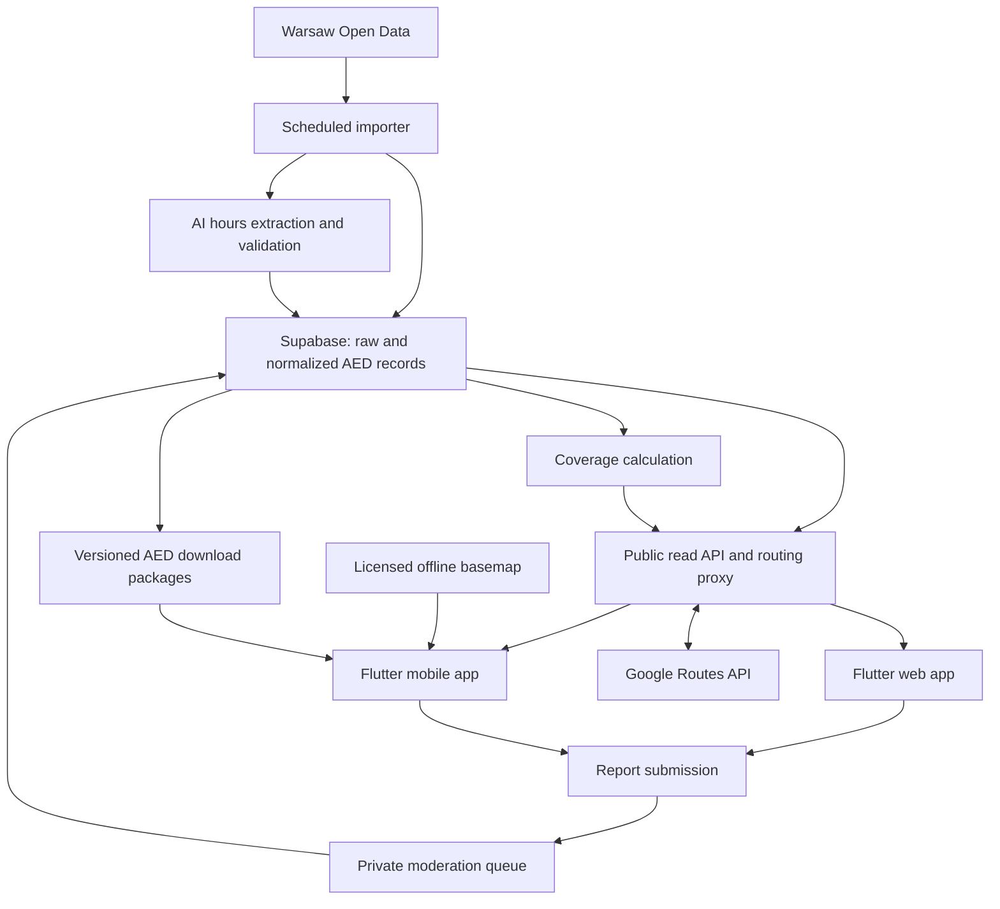

# DefiWawa — Project Plan

> Historical full-scope plan. The current simplified API and database design are in
> [ENDPOINTS.md](ENDPOINTS.md) and [backend/supabase/README.md](backend/supabase/README.md).

Status: initial implementation plan, 17 October 2026. Requirements come from the project brief; technology choices and numerical thresholds below are proposed defaults.

## 1. Product and scope

Build **DefiWawa**, a Warsaw-only defibrillator (AED) map that helps someone find the closest publicly accessible AED that is expected to be available when they arrive. Use Warsaw Open Data as the required source of AED locations and access information.

**Warsaw-only scope:** lock the map to Warsaw in both apps, online and offline. Constrain camera panning and zooming to the city view, and use Warsaw's administrative boundary to restrict AED data, selectable search origins, and coverage analysis. If the user's location is outside Warsaw, keep the map centered on Warsaw, explain the service area, and allow selecting an origin inside the city. Do not silently clamp their GPS location or search for AEDs outside Warsaw.

Deliver two apps with the same interface and behavior:

- **Web app:** a public, linkable demo for the pitch and everyday browsing.
- **Flutter mobile app:** the main product, with downloadable maps and AED information for offline use.

Core features in both apps:

- A map of AEDs, with a subtle walking-time pill next to each individually displayed nearby marker.
- A prominent **“Znajdź defibrylator”** action that selects an accessible nearby AED and builds a walking route using Google Maps Platform.
- AED details, opening hours, access instructions, and data freshness.
- Reports submitted without login or phone verification, protected by rate limits.
- A coverage layer showing areas with no nearby accessible AED.
- No registration or login required to browse, search, or route.

The mobile release also includes offline map downloads. Offline turn-by-turn routing is a later enhancement; the initial offline release provides a real downloadable basemap, AED locations, saved hours, access instructions, and distance-based discovery.

**Meaning of “working”:** the supplied API describes access, not live device health. Keep accessibility and operational condition separate. Say “available according to listed hours,” not “confirmed working,” unless there is independent verification.

## 2. Architecture and shared UI

### Proposed stack

| Area | Decision |
| --- | --- |
| Web and mobile | One Flutter codebase, built separately for web, Android, and iOS |
| Shared interface | Shared widgets, typography, colors, spacing, icons, map overlays, and interaction states |
| State and domain logic | Shared Dart availability evaluator, repositories, and routing contracts |
| Backend | Supabase Postgres with PostGIS, Edge Functions, Storage, and scheduled jobs |
| Online map | Google Maps, behind a platform adapter |
| Online walking routes | Google Routes API through a backend proxy |
| Offline mobile map | Separate renderer using a licensed downloadable OSM-derived map package |
| Offline AED storage | Local SQLite database and versioned download manifests |
| Hours interpretation | Backend AI extraction with strict schema validation and a review queue |
| Report abuse protection | No verification; database rate limits per client IP and per AED |

Flutter supports web deployment, making a shared implementation a practical way to keep both apps consistent. Validate map overlays, browser load time, and accessibility in an early prototype. [Flutter web documentation](https://docs.flutter.dev/platform-integration/web)



Use identical controls and visual tokens across apps. On mobile, details appear in a bottom sheet; on desktop, the same content can occupy a side panel. Native permission prompts and the mobile download manager are platform-specific. Keep marker styles and controls consistent when the offline basemap differs from the online one.

Suggested repository structure:

```text
app/                       # Flutter app with web and mobile targets
packages/domain/           # AED models, hours evaluation, ranking rules
packages/design_system/    # Shared widgets and visual tokens
supabase/migrations/       # Tables, indexes, RLS, and database functions
supabase/functions/        # Import, parsing, routing, reporting, downloads
scripts/                   # Map packaging and coverage generation
fixtures/                  # Source samples and shared availability test cases
docs/                      # Data contracts, setup, and operational notes
```

## 3. Main user flows

### Find an AED

1. Open directly to the map locked to Warsaw, with no onboarding barrier.
2. Tap “Znajdź defibrylator” and grant location permission if needed.
3. Find nearby candidates, evaluate public access and opening hours, and retrieve walking times.
4. Select the eligible AED with the shortest computed walking time among evaluated candidates.
5. Draw the walking route and show time, distance, address, entrance instructions, and availability.
6. Offer nearby alternatives and allow the user to select another AED.

If location permission is denied or positioning fails, allow placing an origin pin. Do not silently use a demo location as the user's location. A pitch-only simulated location must be clearly labeled.

### Browse and inspect

- Show marker states for open according to schedule, closed, unknown hours, and confirmed unavailable.
- Use text/icons as well as color.
- Add small pills such as “4 min” beside visible nearby AED markers. While loading, show a placeholder; on failure, show “—” with an explanation in details.
- Cluster markers at low zoom levels. Compute times when individual markers become visible, in bounded batches; do not request times for the entire city on every map movement.
- Show source wording alongside normalized opening hours, including access restrictions and indoor placement.

### Report an issue

1. Open an AED and choose “Zgłoś problem.”
2. Select a category: missing AED, apparent malfunction, inaccessible entrance, incorrect hours, incorrect location, or other.
3. Enter a short explanation.
4. Submit the report and receive a confirmation that it awaits review.

Preserve the draft through submission errors. Reporting must never block finding an AED.

### Download for offline use — mobile

Choose Warsaw or a supported district package, see its size and update date, download it, and then use the map and AED details in airplane mode. The web app can link to the mobile app for this capability.

### Explore coverage gaps

Switch to a clearly labeled “Zasięg AED” layer. Compare coverage for all listed public AEDs, AEDs available at a selected time, and 24/7 AEDs. Selecting an underserved area explains its nearest AED distance, threshold, and data timestamp.

## 4. Warsaw Open Data ingestion

### Source contract

Use the supplied response as the initial fixture. Before implementation, confirm the exact official endpoint, dataset/resource identifier, API-key requirements, pagination, response envelope, update metadata, and reuse attribution. The official portal could not be retrieved during this planning pass, so no endpoint or dataset ID is assumed here. Discovery starts at [Warsaw Open Data](https://dane.um.warszawa.pl/).

The example uses `geometry.coordinates: [[longitude, latitude]]`, despite declaring a Point. Normalize that specific nested form; support standard `[longitude, latitude]` only through an explicit validated adapter. For the example, longitude is `21.0148748892902` and latitude is `52.2086170695684`.

| Source field | Normalized use |
| --- | --- |
| `defibrillator_id` | Stable source identifier, stored as text |
| `geometry.coordinates` | WGS84 point, normalized to PostGIS geography |
| `device_access_description` | Original hours/access text and AI extraction input |
| `device_availability` | Source availability classification; retain original value |
| `device_public_access` | Public, restricted, or unknown access |
| `device_location` | Indoor/outdoor placement |
| `device_manufacturer` | Manufacturer |
| `location_object_name` | Building or venue name |
| `location_description` | Entrance and on-site location instructions |
| `location_street`, `location_building` | Street address |
| `location_postcode`, `location_city` | Postal code and city |

### Refresh pipeline

Run every **two hours**, with a manual retry option. Supabase supports scheduled Edge Function invocation through `pg_cron` and `pg_net`; keep invocation secrets in Vault. [Supabase scheduling documentation](https://supabase.com/docs/guides/functions/schedule-functions)

1. Acquire a job lock and fetch the complete source snapshot with retries and timeouts.
2. Validate the envelope, record count, IDs, coordinates, and required fields. Quarantine malformed rows and unexpected changes.
3. Store source provenance, ingestion timestamp, raw payload, and content hashes.
4. Upsert records by source ID. Parse hours only when relevant access text or classifications change.
5. Run AI work through a retryable queue so a slow model does not block imports. Publish new/changed unresolved schedules as unknown until validated.
6. Publish a coherent dataset version; regenerate affected coverage data and offline AED packages.
7. Record completion, counts, failures, and freshness metrics.

An incomplete response, upstream error, or suspiciously empty dataset must not delete existing AEDs. Preserve the last successful snapshot. Mark missing records inactive only after two complete successful snapshots confirm absence, with an audit trail. Keep reviewed overrides separate so imports cannot erase them.

Distinguish `last_fetched_at` from `source_updated_at` and `last_verified_at`. A successful fetch does not mean the city recently inspected the AED. Flag a missed synchronization after two expected intervals.

## 5. AI normalization of opening hours

AI runs during ingestion, never while someone presses “find.” Its job is to convert Polish free text into structured evidence, preserving ambiguity.

### Schedule contract

Use `Europe/Warsaw`, ISO weekday numbers (`1` = Monday), explicit intervals, and separate per-day states: `open_intervals`, `closed`, or `unknown`. Empty intervals alone must not imply closure. Include date exceptions, holiday policy, access conditions, parser/model version, source-text hash, and review status.

Example extraction for the supplied record:

```json
{
  "timezone": "Europe/Warsaw",
  "kind": "weekly",
  "weekly": {
    "1": {"state": "open_intervals", "intervals": [["08:00", "18:00"]]},
    "2": {"state": "open_intervals", "intervals": [["08:00", "16:00"]]},
    "3": {"state": "open_intervals", "intervals": [["08:00", "16:00"]]},
    "4": {"state": "open_intervals", "intervals": [["08:00", "16:00"]]},
    "5": {"state": "open_intervals", "intervals": [["08:00", "16:00"]]},
    "6": {"state": "unknown", "intervals": []},
    "7": {"state": "unknown", "intervals": []}
  },
  "date_exceptions": [],
  "holiday_policy": "unknown",
  "access_conditions": [],
  "review_status": "validated_partial",
  "evidence": "Poniedziałek: godz. 8:00-18:00; Wtorek-Piątek: godz. 8:00-16:00"
}
```

Saturday and Sunday are unspecified in the source, so they remain unknown. If the city documents that omitted days mean closed, encode that as a versioned source rule instead of an AI assumption.

### Extraction and validation rules

- Handle explicit 24/7 access, Polish weekday ranges, split shifts, overnight hours, seasonal periods, holidays, and phrases such as “during building opening hours.”
- Preserve conditions such as “ask security” separately from opening intervals.
- Treat source text as data; the model has no tool access and must ignore instructions embedded in it.
- Require structured JSON and validate types, weekday coverage, time bounds, contradictions, evidence, and exception precedence.
- Split overnight intervals across local calendar days. Use inclusive opening and exclusive closing boundaries.
- Accept explicit, unambiguous schedules only after deterministic checks. Model confidence alone cannot establish correctness.
- Use deterministic parsing for simple recognized forms and AI for free text; retain provenance for either path.
- Leave unresolved schedules unknown and queue them for review. Never invent missing hours or turn an AI failure into 24/7 access.
- On a source change, do not keep an old schedule marked current while the replacement awaits parsing.

The availability evaluator must handle timezone conversion and daylight saving changes. Date exceptions override weekly hours. For limited-hours premises on holidays with an unknown policy, show unknown rather than assuming the regular weekday schedule. An explicit unconditional 24/7 statement can apply across days unless the source provides exceptions.

## 6. Choosing the closest accessible AED

“Closest” means **shortest evaluated walking time**, since straight-line distance can be misleading around the Vistula, railways, and restricted entrances.

1. Use PostGIS to obtain nearby records with valid coordinates and public access.
2. Exclude inactive records, reviewed unavailable devices, and currently closed locations. Keep unknown/restricted access as separate fallback results.
3. Start with the nearest 20 plausible candidates within 2 km, as a tunable request budget.
4. Request a walking route matrix from the user's origin to those AEDs.
5. Evaluate each candidate at predicted arrival time and require its open interval to extend through arrival plus a configurable two-minute access buffer. The buffer is a product default, not a medical standard.
6. Rank eligible routes by walking duration, then distance. Fetch the selected route geometry.
7. Expand the radius/candidate set when none qualify, routes fail, or barriers make the initial results poor. Bound calls and offer manual alternatives if the search budget is exhausted.
8. Re-evaluate as time passes or the user moves materially; debounce requests and cancel stale responses.

A limited shortlist does not prove the globally fastest route. Describe the result as the fastest among checked nearby AEDs; broaden candidate evaluation if exhaustive ranking becomes a requirement. Never hide uncertainty behind a claim of guaranteed availability.

Use `computeRouteMatrix` for durations and distances, including per-element status/condition checks. Use `computeRoutes` for the selected polyline. Return partial results if some destinations fail. [Google route matrix documentation](https://developers.google.com/maps/documentation/routes/compute_route_matrix) and [Routes API overview](https://developers.google.com/maps/documentation/routes)

Keep the Routes API key on the server. Restrict client map keys by supported app/site restrictions. Apply rate limits, request bounds, and spend alerts to the anonymous routing endpoint. Keep route responses transient; exclude Google route results from permanent AED records and offline packages.

For EEA billing accounts, Google's current guidance restricts displaying route descriptions or steps with a map. Plan the map view around route geometry, ETA, distance, and our own AED access instructions; check the applicable agreement before final integration. [Google EEA Routes guidance](https://developers.google.com/maps/comms/eea/routes)

Include required attribution and public privacy/terms pages. Follow the relevant display and caching rules rather than assuming Google results may be stored for offline use. [Google Routes policies](https://developers.google.com/maps/documentation/routes/policies)

If Google routing fails, show straight-line distance and a clearly labeled estimate only if useful; do not draw a straight line as a walkable route. If no eligible AED is found, explain that and expose unknown-hours alternatives explicitly.

## 7. Offline mobile behavior

An offline package contains:

- A basemap with streets and labels for the selected area, including the required styles, fonts, and icons.
- AED coordinates, normalized schedules, source text, access instructions, reviewed status, and timestamps.
- A manifest with area bounds, schema version, dataset version, package size, checksum, and map attribution.

Use an offline renderer behind the same map interface. Validate a concrete Flutter renderer and package format in the first milestone; possible formats include MBTiles or PMTiles where the selected renderer supports them. Choose a provider permitting packaged offline redistribution or generate tiles from appropriately licensed data.

Do not bulk-download the public `tile.openstreetmap.org` service: its policy prohibits offline downloads. Use a permitted provider or self-hosted tiles. [OpenStreetMap tile policy](https://operations.osmfoundation.org/policies/tiles/)

Downloads support progress, cancellation, storage checks, checksum validation, and atomic replacement. An interrupted update leaves the previous working package intact. Update AED data independently of the much larger basemap when possible.

In airplane mode, the app must cold-start, render the downloaded area, show AED details, and evaluate saved hours locally. Show the download date and “offline — availability may have changed.” GPS can supply a location when available; manual origin selection still works.

Initial offline discovery ranks by straight-line distance, clearly labeled, and shows distance pills rather than claiming Google walking times. No new Google route can be calculated offline. Full offline walking routes require an additional pedestrian graph and routing engine and are deferred.

Reports may be drafted offline, but require connectivity before submission. Outside the downloaded map bounds, explain the missing coverage and retain access to saved AED details.

## 8. Reporting, trust, and privacy

Reporting needs no phone verification, account onboarding, profile, or login gate. Anyone can submit a report for an active AED.

- Limit abuse in the database: 5 reports per client IP per hour and 20 per AED per hour. Trust only the edge-set client IP header, never `x-forwarded-for`.
- Make spam cheap to ignore rather than blocking it: flag implausibly fast or link-bearing reports, silently drop honeypot submissions in the app, and moderate pending reports grouped per AED and category.
- Before public launch, consider Supabase anonymous sign-in with invisible Cloudflare Turnstile to rate-limit per device instead of per IP.
- Use a client-generated report ID as the idempotency key so retries cannot create duplicates.
- Store only a hash of the client IP, for rate limiting; never in public AED data, map packages, analytics, or logs.
- Define retention and deletion for report IP hashes before launch. Avoid persistent location history; send coordinates only when needed for route requests.
- Keep reports pending until reviewed; an unverified report is a hint, not a fact.
- Moderators can accept/reject reports and create time-bounded audited overrides. Confirmed missing/broken/inaccessible AEDs are excluded from automatic selection until resolved.
- The initial moderation interface can be a restricted Supabase dashboard/workflow; it is separate from the public no-login apps.

## 9. Coverage gaps and placement opportunities

For the first version, “underserved” means a place farther than a configurable distance from an eligible AED. Start with a **500 m straight-line threshold** and **250 m grid cells**, explicitly labeled as planning assumptions rather than an emergency-response standard.

Algorithm:

1. Obtain Warsaw's boundary from an attributed source and create a grid in a metric coordinate system.
2. For each cell representative point, calculate distance to the nearest eligible AED using PostGIS geography or a suitable metric projection.
3. Produce three scenarios: all listed public AEDs regardless of hours, confidently 24/7 public AEDs, and public AEDs available at the selected time.
4. Classify cells above the threshold as gaps and merge adjoining cells into display regions.
5. Return polygons, nearest distance, eligible AED count, scenario/time, threshold, and data version.
6. Style gap severity with a readable legend. Distinguish lack of known AEDs from missing/uncertain access information.

Exclude confirmed unavailable devices in every scenario. Evaluate availability consistently with the search feature, but explain that initial coverage uses distance rather than an arrival-time route calculation.

Precompute static scenarios after relevant dataset changes. Refresh current-time coverage as schedules change, even when no new import occurs; key cached results by dataset, overrides, scenario, and time bucket, and expire them at relevant opening/closing boundaries.

Do not run paid Google route matrices across a citywide grid. A later version can use an independently licensed pedestrian network to account for bridges and barriers, then rank potential installation areas by additional people or public places covered. Population and footfall layers are optional enhancements, not prerequisites for the requested distance-based feature.

Cell-center sampling is approximate and can miss variation within a cell. Label the initial layer as **coverage gaps in the available dataset**, not definitive proof that a site requires a new AED. Water, inaccessible land, and dataset omissions can otherwise produce misleading suggestions.

## 10. Backend data model and API boundaries

| Entity | Main contents |
| --- | --- |
| `aed_locations` | Source ID, location, address, placement, public access, source classifications, active flag, provenance |
| `aed_schedules` | Weekly rules, exceptions, timezone, source hash, parser version, validation state |
| `aed_overrides` | Reviewed corrections/condition, reason, reviewer, validity period, audit history |
| `source_snapshots` / `ingestion_runs` | Raw source versions, completeness checks, job status, counts, errors |
| `schedule_parse_jobs` | Pending/retry/review state and validated extraction output |
| `reports` | AED reference, category, text, private client IP hash, moderation state, timestamps |
| `coverage_layers` | Geometry or artifact reference, scenario, threshold, calculation time, source version |
| `offline_packages` | Bounds, asset references, checksum, size, schema/data versions, attribution |

Index geography for nearby lookups, enforce unique source IDs, and keep raw payloads private. Public views expose only sanitized AED, schedule, coverage, and package data.

Public contracts should support viewport AED reads, AED details, nearby discovery, bounded ETA requests, selected routes, coverage layers, and offline manifests. Every response includes relevant freshness/version information. Report submission is public and rate-limited; ingestion and moderation endpoints require privileged credentials.

Use RLS and narrow database grants: anonymous users can read public data and submit rate-limited reports, and clients cannot edit AED records or inspect other reports. Service-role credentials, AI credentials, and city API keys stay server-side.

## 11. Delivery milestones

### Milestone 1 — Establish the foundations

- [ ] Confirm the Warsaw AED endpoint and obtain a complete real snapshot.
- [ ] Confirm source reuse/attribution and document observed availability values.
- [ ] Create the Flutter web/mobile structure and shared design tokens.
- [ ] Prototype online map markers with ETA pills on web and mobile.
- [ ] Apply Warsaw camera/zoom limits and boundary checks to both apps and backend discovery; handle locations outside the city explicitly.
- [ ] Prove a downloadable offline basemap renders after an airplane-mode cold start.
- [ ] Set up Supabase, Google Maps billing/keys, and AI extraction credentials.

Exit: real source data is understood and the shared UI/map approach works on target platforms.

### Milestone 2 — Data and availability

- [ ] Implement schema, spatial indexes, RLS, importer, and two-hour schedule.
- [ ] Implement structured hours extraction, validation, review state, and provenance.
- [ ] Implement the shared availability evaluator and fixture-based tests.
- [ ] Expose public AED reads with freshness and source attribution.

Exit: real AEDs display with correct, explainable open/closed/unknown states.

### Milestone 3 — Online discovery and pitch web app

- [ ] Implement location permission/manual origin flows and candidate lookup.
- [ ] Add walking-time matrix, arrival-time filtering, route geometry, and alternative selection.
- [ ] Add subtle time pills, marker clustering, AED details, and failure states.
- [ ] Deploy the web app with a shareable URL and pitch QR code.

Exit: a person can open the link, find an eligible AED, and inspect the walking route without logging in.

### Milestone 4 — Reporting and coverage

- [ ] Complete real report submission, rate limiting, draft preservation, and moderation.
- [ ] Generate the first coverage grid and all-public/24-hour/selected-time scenarios.
- [ ] Add the coverage layer, legend, selection details, and threshold control.

Exit: reports reach a private queue and coverage gaps are visible in both apps.

### Milestone 5 — Offline mobile completion

- [ ] Package/download the basemap and normalized AED data.
- [ ] Add atomic updates, local search, saved-hours evaluation, and offline status.
- [ ] Verify restart, interrupted download, low-storage, and missing-package behavior.
- [ ] Produce installable mobile builds with the same interface as the web demo.

Exit: the downloaded Warsaw map and AED discovery work without connectivity.

### Milestone 6 — Release and pitch rehearsal

- [ ] Run the acceptance checks below on web, Android, and iOS targets.
- [ ] Verify key restrictions, public/private data separation, quotas, and error monitoring.
- [ ] Rehearse a daytime search, a closed-nearest-AED case, a coverage gap, a report, and an airplane-mode search.
- [ ] Keep any simulated data/location visibly marked; use real Warsaw-derived data for the primary pitch.

## 12. Acceptance checks

| Area | Required evidence |
| --- | --- |
| Source and refresh | Warsaw source IDs/provenance retained; refresh runs every two hours; failed/partial fetch cannot erase the map |
| Warsaw-only scope | Both maps enforce Warsaw camera/zoom limits online and offline; backend searches and manual origins stay inside the city boundary; outside-city GPS shows a service-area message |
| Hours | Supplied example opens Monday 08:00–18:00 and Tuesday–Friday 08:00–16:00; omitted weekends stay unknown |
| Edge cases | Split/overnight shifts, DST, date exceptions, holidays, malformed text, conflicting classifications, and AI failures covered |
| Selection | A nearby closed, restricted, or confirmed unavailable AED is skipped; closing-before-arrival candidates are rejected |
| Routing | Walking durations determine ranking; partial API failures do not appear as successful routes; location denial has a usable fallback |
| Pills | Visible individual nearby markers show computed times or explicit loading/unavailable states; clustering bounds API calls |
| UI parity | Shared layouts and components match at equivalent viewport sizes; keyboard, screen-reader, and large-text flows remain usable |
| Offline | Cold-start in airplane mode renders downloaded basemap/AEDs, evaluates hours, and shows freshness without online API requests |
| Reporting | Submission works without login; rate limits reject floods; retries do not duplicate; report data cannot be read publicly |
| Coverage | A synthetic sparse area is marked underserved; closing a scheduled AED changes time-specific coverage; distances use meters correctly |
| Updates | Interrupted imports/downloads retain a usable previous version; reviewed overrides survive source refreshes |

Proposed performance budgets: show cached AEDs within one second after the map is ready and complete a nearby online search within three seconds on a typical connection. Measure these during implementation; they are targets, not guarantees about external services.

## 13. Decisions to settle during implementation

- Exact Warsaw source endpoint, authentication, dataset license, and meaning of omitted opening days.
- Supported launch mobile platforms and browser/device test matrix.
- Final offline map supplier, renderer, distribution rights, storage budget, and zoom range.
- AI model/provider, expected usage, and monthly API spending limits.
- Reviewer ownership and report retention policy.
- Whether later releases need full offline pedestrian routing, population-weighted placement suggestions, or a dedicated moderation app.

These decisions do not change the core scope: Warsaw Open Data, shared web/mobile UI, availability-aware Google walking routes, periodic Supabase synchronization, rate-limited reports, mobile offline maps, and coverage gaps.
