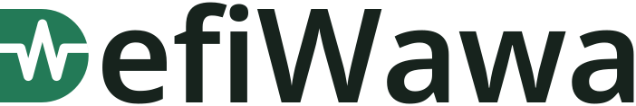
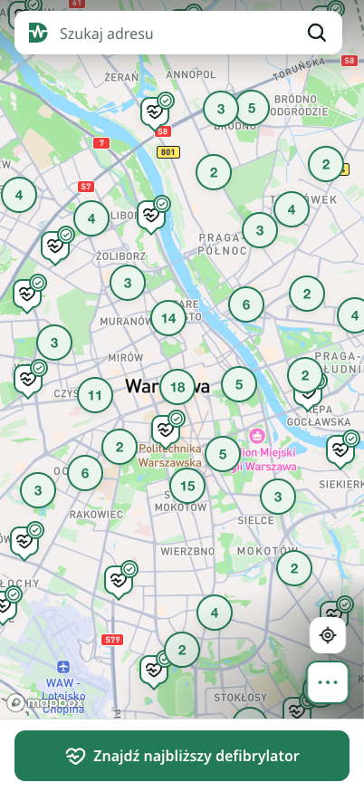
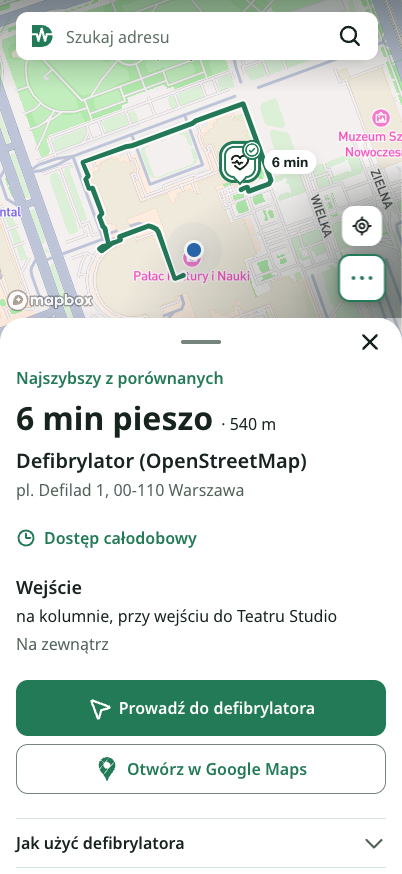
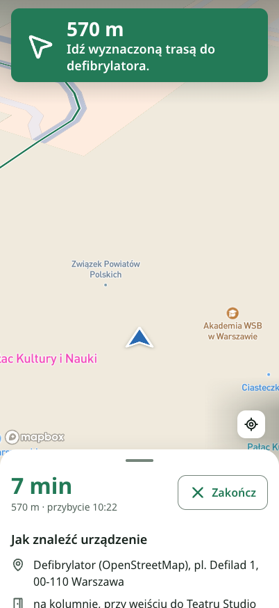
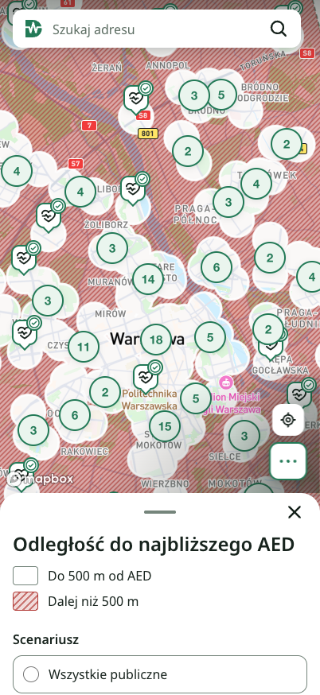
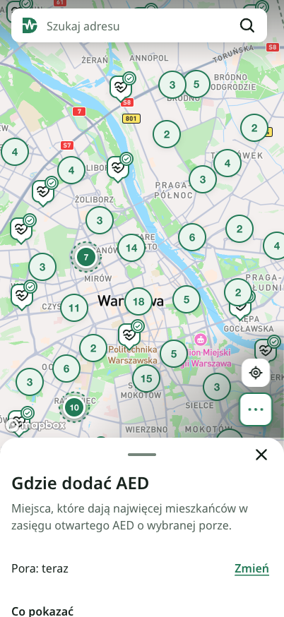
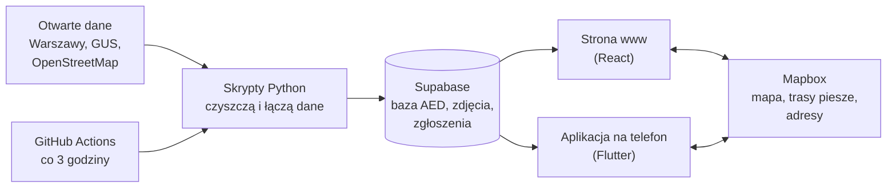

<p align="center">
  <picture>
    <source media="(prefers-color-scheme: dark)" srcset="docs/brand/defiwawa-horizontal-dark.svg">
    
  </picture>
</p>

<p align="center">
  <b>Czy zdążysz dobiec do otwartego defibrylatora?</b><br>
  System, który prowadzi od „gdzie jest najbliższy AED” aż do „gdzie miasto powinno postawić następny”.
</p>

<p align="center">
  <a href="https://defiwawa.pl"></a>
  <a href="3_Joblessness_DefiWawa.pptx"></a>
</p>

<p align="center">
  
  
  
  
  
  
  
  
  
  
  
  
  
</p>

| | |
| --- | --- |
| **Projekt** | DefiWawa |
| **Zespół** | Joblessness, numer zespołu **24** |
| **Wyzwanie** | 3 |
| **Prezentacja** | [`3_Joblessness_DefiWawa.pptx`](3_Joblessness_DefiWawa.pptx) |
| **Działa na żywo** | [defiwawa.pl](https://defiwawa.pl) (otwórz na telefonie) |

---

## Problem w jednym zdaniu

Defibrylator zamknięty o 3 w nocy to nie defibrylator. Większość warszawskich AED wisi w biurach, szkołach
i na stacjach metra. Zwykłe mapy pokazują, **gdzie** są, ale nie mówią, **czy da się do nich wejść teraz**.

Z naszych obliczeń: we wtorek o 14:00 otwartych jest 569 AED i 3 na 4 mieszkańców ma któryś w odległości do 500 m.
We wtorek o 3:00 otwartych jest tylko 93 i tak blisko AED ma już tylko 1 na 5 mieszkańców.
A w Warszawie każdego dnia zdarza się około 8 nagłych zatrzymań krążenia.

## Co robi DefiWawa

To nie tylko mapa. DefiWawa przechodzi z tobą przez wszystkie kroki, od szukania do pomocy, i pomaga miastu
zdecydować, gdzie AED brakuje.

| | Krok | Co dostajesz |
| --- | --- | --- |
| 🔎 | **Znajdź** | Mapa wszystkich AED w Warszawie. Widać, które są otwarte **teraz**. Jeden przycisk „Znajdź najbliższy defibrylator” sprawdza kilka najbliższych i wybiera ten, do którego dojdziesz najszybciej pieszo. Gdy znamy twoje położenie, przy znacznikach widać czas dojścia. Można też wpisać adres albo wskazać punkt na mapie. |
| 🧭 | **Dojdź** | Trasa piesza na mapie i nawigacja krok po kroku: kierunek, ile metrów zostało, o której będziesz na miejscu. Albo jedno kliknięcie i trasa otwiera się w Google Maps. |
| ❤️ | **Pomóż** | Karta AED: zdjęcie szafki, wejście, piętro, godziny. Prosta instrukcja „Jak użyć defibrylatora” (według wytycznych Europejskiej Rady Resuscytacji) i przycisk „Zadzwoń pod 112”. |
| 🚩 | **Sprawdź i zgłoś** | Dostępność liczymy z godzin otwarcia i uczciwie piszemy „dostępny według godzin”, a nie „działa”. Jeśli AED nie ma, jest zamknięty albo adres się nie zgadza, każdy może to zgłosić przyciskiem „Zgłoś problem”, bez logowania. Zgłoszenia trafiają do kolejki do sprawdzenia, a limity chronią przed spamem. |
| 🏙️ | **Dla miasta** | Warstwa **„Zasięg”** pokazuje na czerwono miejsca, gdzie w promieniu 500 m nie ma otwartego AED, o dowolnej godzinie tygodnia. Panel **„Gdzie dodać AED”** podaje adresy, w których nowy AED da dostęp największej liczbie mieszkańców (osobno liczymy osoby 65+), albo które istniejące, zamknięte AED warto udostępnić całą dobę. Do tego szacunkowy koszt na podstawie projektów z Budżetu Obywatelskiego. |

Wszystko działa bez rejestracji i logowania. Jest strona internetowa i aplikacja na telefon (iPhone i Android)
z takim samym wyglądem i działaniem.

<table>
  <tr>
    <td align="center"><br><sub>Mapa: zielone są otwarte teraz</sub></td>
    <td align="center"><br><sub>Najbliższy otwarty AED i trasa</sub></td>
    <td align="center"><br><sub>Nawigacja krok po kroku</sub></td>
    <td align="center"><br><sub>Zasięg: czerwone = brak AED blisko</sub></td>
    <td align="center"><br><sub>Gdzie miasto powinno dodać AED</sub></td>
  </tr>
</table>

## Jak to działa



**1. Zbieramy dane.** Bierzemy listę AED z otwartych danych Warszawy (710 urządzeń z godzinami, opisem i zdjęciami)
i dokładamy 187 publicznych AED z OpenStreetMap. Razem prawie 900 urządzeń.

**2. Czyścimy je.** Godziny w danych są wpisane zwykłym tekstem, np. „pn–pt 8–16, sob 9–13”. Nasz parser zamienia je
na tydzień w kalendarzu. Gdy tekst jest zbyt nietypowy, pomaga model AI (gpt-4o-mini). Wysyłamy mu tylko sam tekst
godzin, bez nazw i adresów, a odpowiedź zapamiętujemy. Jeśli godzin nie da się ustalić, nie udajemy:
taki AED pokazujemy jako „niedostępny, brak danych”.
Z opisu wyciągamy też piętro, a zdjęcia czyścimy z metadanych (EXIF).

**3. Liczymy mieszkańców.** Spis GUS 2021 podaje mieszkańców w kratkach 1 × 1 km. Rozkładamy ich na 110 517 budynków
mieszkalnych według powierzchni, więc wiemy, gdzie mieszka 1,9 mln osób, z dokładnością do 100 m.
Dzięki temu dla każdego pół godziny tygodnia liczymy, ilu ludzi ma otwarty AED blisko, i szukamy miejsc,
gdzie nowy AED pomoże najbardziej.

**4. Szukamy najbliższego.** Po naciśnięciu przycisku aplikacja bierze twoją lokalizację (albo wpisany adres),
baza (PostGIS) wybiera najbliższe AED otwarte w tej chwili, a Mapbox liczy prawdziwy czas dojścia pieszo do kilku z nich.
Wygrywa ten, do którego dojdziesz najszybciej, nie ten najbliżej w linii prostej.

**5. Prowadzimy.** Rysujemy trasę i prowadzimy krok po kroku. Gdy zejdziesz z trasy, wyznaczamy ją od nowa.

**6. Odświeżamy.** GitHub Actions co 3 godziny pobiera nową listę AED z API miasta i przebudowuje dane.

## Technologie po ludzku

| Technologia | Po co jej używamy |
| --- | --- |
| **Flutter + Dart** | Aplikacja na telefon (iPhone i Android) z jednego kodu. |
| **React + TypeScript + Vite** | Strona [defiwawa.pl](https://defiwawa.pl), działa w każdej przeglądarce, też na telefonie. |
| **Mapbox** | Mapa, trasy piesze, czas dojścia i wyszukiwanie adresów. |
| **Supabase** (PostgreSQL + PostGIS) | Baza danych AED, zdjęć i zgłoszeń. PostGIS to dodatek, który szybko liczy odległości na mapie. |
| **Edge Functions** (Deno) | Mały serwer w chmurze: wybiera najbliższy otwarty AED, liczy czas dojścia i trasę. |
| **Python** | Skrypty, które pobierają i czyszczą dane: godziny, piętra, zdjęcia, mieszkańców, ranking nowych miejsc. |
| **OpenAI gpt-4o-mini** | Pomaga zrozumieć nietypowo zapisane godziny otwarcia, gdy zwykły parser się poddaje. |
| **OpenStreetMap** | Dodatkowe publiczne AED, granica Warszawy, dzielnice. |
| **GitHub Actions** | Automat, który co 3 godziny odświeża listę AED. |

## Dane

| Źródło | Co z niego bierzemy |
| --- | --- |
| [dane.um.warszawa.pl](https://dane.um.warszawa.pl) | Lista AED: adresy, godziny, opisy wejścia, zdjęcia |
| [dane.um.warszawa.pl](https://dane.um.warszawa.pl): Budżet Obywatelski 2019–2025 | Koszt jednego AED (mediana z 31 projektów) |
| GeoServer m.st. Warszawy | Budynki i adresy |
| GUS, Narodowy Spis Powszechny 2021 | Mieszkańcy w siatce 1 km |
| © [OpenStreetMap](https://www.openstreetmap.org/copyright) contributors (ODbL) | 187 dodatkowych AED, granica miasta |

Pokazujemy dostęp według godzin podanych w źródle. To nie jest potwierdzenie, że urządzenie działa.

## Co jest w repozytorium

```
3_Joblessness_DefiWawa.pptx   prezentacja
backend/
  pipeline/                   skrypty Python: pobieranie i czyszczenie danych, mieszkańcy, ranking miejsc
  supabase/                   baza danych (migracje, dane startowe) i Edge Functions (szukanie, trasy)
  data/                       gotowe dane: AED, mieszkańcy, propozycje nowych miejsc
frontend/
  web/                        strona www (React)
  mobile/                     aplikacja na telefon (Flutter)
docs/                         zrzuty ekranu i logo do tego pliku
PLAN.md, DESIGN.md, ENDPOINTS.md   plan produktu, zasady wyglądu, opis API
```

## Jak uruchomić

Potrzebne są: publiczny token Mapbox i adres oraz publiczny klucz projektu Supabase
(wzory w plikach `.env.example`).

**Strona www**

```sh
cd frontend/web
cp .env.example .env.local   # wpisz VITE_MAPBOX_TOKEN, VITE_SUPABASE_URL, VITE_SUPABASE_PUBLISHABLE_KEY
npm install
npm run dev
```

**Aplikacja na telefon**

```sh
cd frontend/mobile
cp .env.example .env          # wpisz MAPBOX_TOKEN, SUPABASE_URL, SUPABASE_PUBLISHABLE_KEY
flutter pub get
flutter run --dart-define-from-file=.env
```

**Dane i baza**

```sh
cd backend
WARSAW_API_KEY=... python3 -m pipeline.fetch_aed   # pobierz świeżą listę AED z API miasta
python3 -m pipeline.build --no-llm                  # zbuduj data/out/aed.json (z OPENAI_API_KEY bez --no-llm)
python3 -m pipeline.seed_sql      # zapisz dane startowe do supabase/seed.sql
```

Szczegóły: [frontend/web](frontend/web/README.md), [frontend/mobile](frontend/mobile/README.md),
[baza danych](backend/supabase/README.md), [Edge Functions](backend/supabase/functions/README.md).

## Zespół

**Joblessness**, zespół nr 24. Wyzwanie 3.
