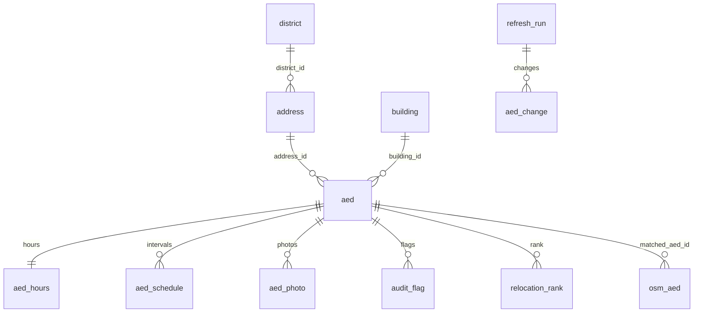

# Database schema

`schema.sql` is plain PostgreSQL 14+ (no extensions). It was applied to a clean PostgreSQL 17 and loaded with all 710 real AED records; the constraints reject bad floors, postcodes, coordinates and schedule rows. `postgis_optional.sql` was not run.

Also: `hours_cache` (LLM answers by exact string), `population_cell` (GUS 1 km grid), `coverage_hour` (168 hours x radius), `bo_project` (participatory budget, no author names).

## Address and map links

- `address.full_address` is generated: `ul. Rakowiecka 25/27, 02-517 Warszawa`. The SCB street field often has no prefix, so `fmt_street()` adds `ul.` unless the street already starts with `al.`, `pl.`, `os.` and so on, or uses the official name from the city address point.
- `address.official_lon/lat` is the city address point (`punkty_adresowe`) found by street + number. The SCB coordinate of an AED turned out to be the address point itself (median offset 0 m), so it locates the **building**, not the device. The floor and `location_description` say where inside.
- The view `aed_public` is what the app reads. It returns `full_address`, `floor_label`, `open_now` and ready links: `google_maps_url`, `google_directions_url` (walking), `osm_url`, `apple_maps_url`, `geo_uri`. Links use the official address point when there is one, otherwise the AED coordinate.
- **Address match on the real data:** 447 addresses matched, 25 matched far (> 100 m, flagged), 147 not matched. The 147 are mostly streets written with initials (`F. Klimczaka` vs `ulica Filipa Klimczaka`); the loader needs fuzzy matching to bring this down.
- `district_id` is empty for now. The 18 district polygons are in `data/geo/osm_dzielnice_raw.json` as unjoined OSM ways, so the loader has to assemble the rings first.

## Where each field comes from

| Column | Source |
|---|---|
| `aed.*`, `address.street_raw`, `building_no`, `postcode` | SCB API `get_scb_lokalizacja_defibrylatorow` |
| `aed_hours`, `aed_schedule` | `pipeline/hours.py` (regex), `pipeline/llm_hours.py` (LLM), 24/7 from `device_availability = Tak` |
| `aed.floor` | `pipeline/floor.py` from the description (`text`), else OSM `level` within 30 m (`osm`) |
| `aed.in_building` | SCB `device_location`; `in_footprint`, `building_*` from `pipeline/building.py` |
| `audit_flag` | suspicious reasons, address/coordinate mismatch, unknown hours (codes listed in `schema.sql`) |

## Checks on the real data

- At Saturday 03:00 only 101 of 710 AEDs are open; on Tuesday 14:00, 663. 42 are `unknown` and give `NULL`.
- 393 flags: 75 `247_indoors_unstaffed`, 28 `coord_far_from_address`, 42 `hours_unknown`, 1 `247_but_limited_text`.

## Privacy

- Photos: serve only `aed_photo.public_file_name` (resized, no EXIF). Originals carry phone model and often GPS.
- `bo_project` has no author names (personal data).
